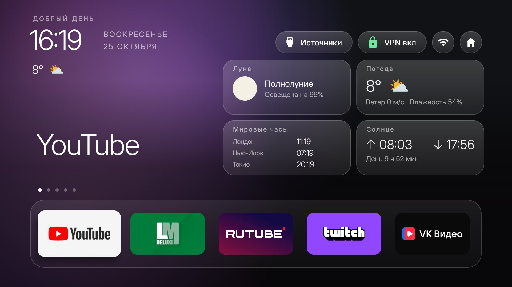
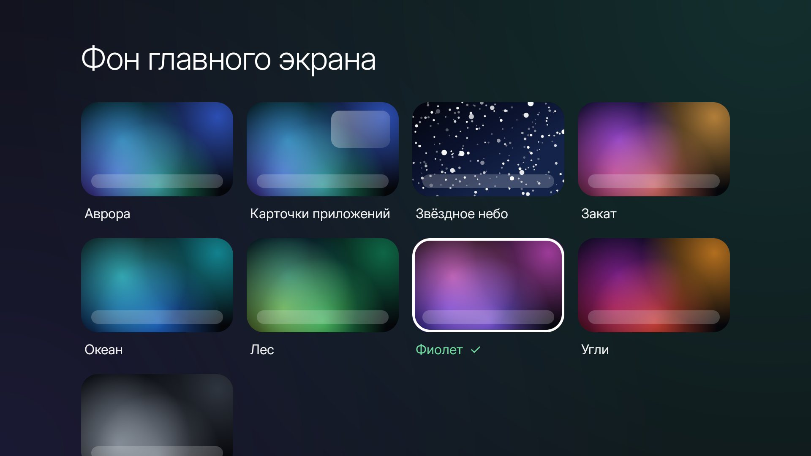
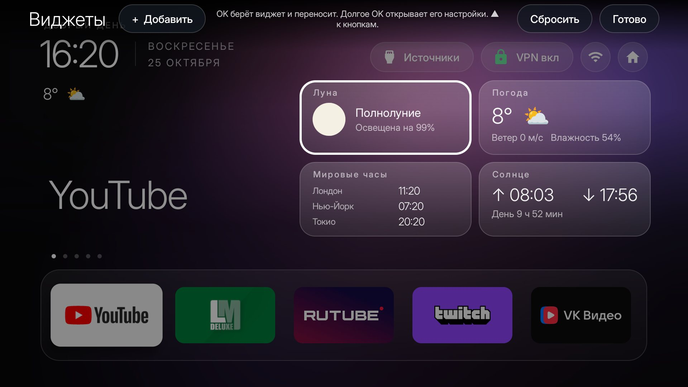
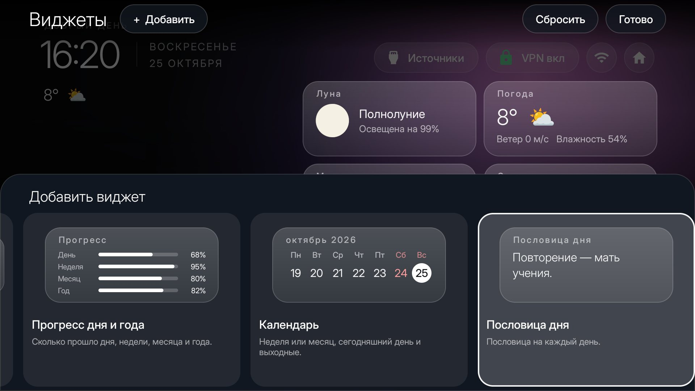
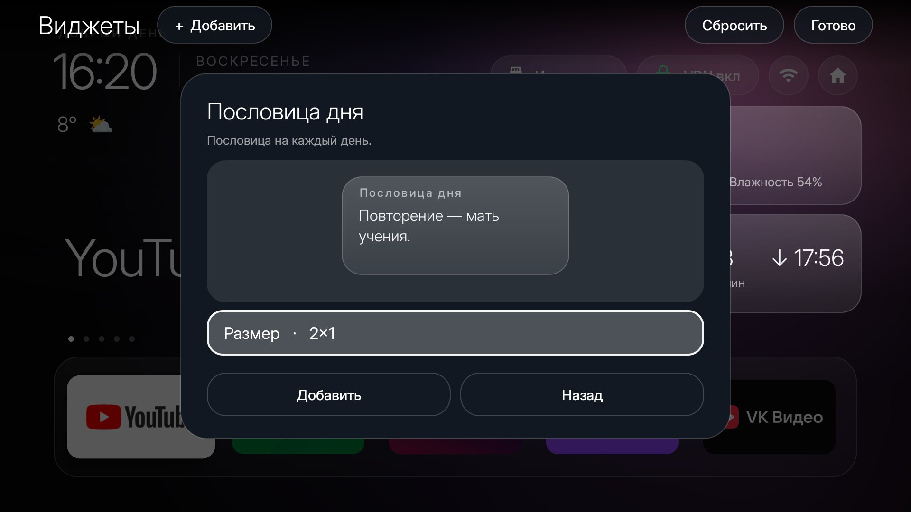
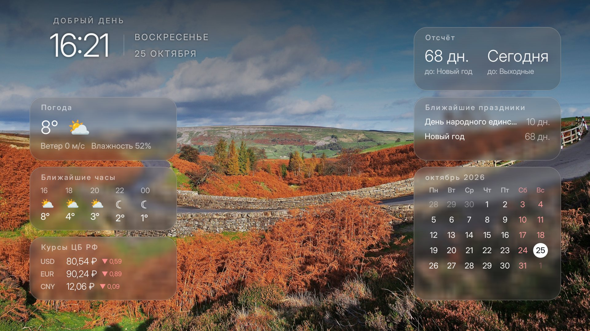

# Liquid Glass Home for Philips TA1

A fork of the Clean Your TV launcher, built and tested on a Philips 65PUS8729/60 (Google TV 14). It keeps the
launcher's job (a fast Home, the stock launcher disabled, nothing uninstalled) and adds a glass look, widgets
and a matching screensaver. It is a fork, not a patch: it adds network access and effects the core launcher
refuses on purpose (see [AGENTS.md](AGENTS.md)), so it lives here, not in the main repository.



## What is in it

- **Home**: glass pills and dock, an animated aurora behind everything (30 frames a second, no bitmaps), and a
  choice of ten backgrounds in Launcher settings > Background: the aurora, the focused app's own pictures,
  a night sky, and six colour schemes (sunset, ocean, forest, violet, embers, graphite).
  
- **Widgets**: 24 cards on a 4 x 2 grid on Home and a 7 x 4 grid on the screensaver, each 2 x 1, 3 x 1, 2 x 2
  and so on where it makes sense: weather, hourly forecast, moon and its phases, sun, world clocks, progress of
  the day and year, calendar with the weekend marked, rates of the Bank of Russia, a day in history, TV status,
  countdowns, clock, week number, holidays, a fact, a quote, a word, the date, the season, a tip, an idea for
  dinner and a film to watch. Text shrinks rather than gets cut off.
- **Editor**: Launcher settings > Widgets opens the editor on the real Home. `+` lists the cards that are not
  on the screen yet with a preview and a line on what each shows; OK on a card on the screen picks it up, the
  arrows carry it (others make way, swap or the card shakes when there is no room), OK sets it down, a long OK
  opens its page (size, options, remove).
  
  
  
- **Photo screensaver** (`addons/photo-screensaver`): 4K pictures from Wikimedia Commons, NASA and the Met
  (136 sources to tick, 400 MB cache, author and licence on screen), the clock and the same widgets over a
  blurred backdrop, with glass settings and an editor of its own.
  
- **Philips TA1 list and theme**: `examples/philips-google-tv-ta1`.

## Network and privacy

The core launcher has no `INTERNET` permission; this fork does, and uses it only for:

| What | Where it goes |
|---|---|
| Weather | api.met.no (MET Norway), with the TV's rough location rounded to about 1 km, only while a weather card or the weather line is on |
| Exchange rates | cbr-xml-daily.ru, only while the card is on |
| "On this day" | ru.wikipedia.org, only while the card is on |
| App pictures for Home | https URLs the apps publish in the TV provider (`READ_TV_LISTINGS`), only with that background |
| Screensaver pictures | commons.wikimedia.org, images-api.nasa.gov, metmuseum.org, only for the sources you tick |

No analytics, no accounts. Everything else is computed on the TV.

## Install

The same as the core launcher (JDK 17, Android SDK 34); an APK is not committed:

```bash
TV_HOST=<tv ip> launcher/build-and-install.sh
# the app-picture background reads the TV provider:
tools/venv/bin/python -I tools/tv.py 'pm grant com.gathin.tvhome android.permission.READ_TV_LISTINGS'
# theme (aurora, glass dock, widgets on): 
TV_HOST=<tv ip> tools/theme.sh examples/philips-google-tv-ta1/theme
# screensaver:
cd addons/photo-screensaver && ./gradlew assembleRelease
```

The widgets library is shared source in `shared/widgets`, compiled into both apps (see the `sourceSets` lines in
the two `build.gradle` files).

## Tested on

Philips 65PUS8729/60, Google TV 14: cold reboot back to Home, 0.28 % janky frames on Home (8126 frames), the
editor, the ten backgrounds, the screensaver started by the TV's idle timer and from the Home card. Not tried
on other TVs. HDMI and Live TV were not exercised.

## Licences

The code is MIT like the rest of the repository. The Inter font is under the SIL Open Font Licence
(`launcher/FONT-LICENSE-OFL-INTER.txt`). Pictures are shown with the author and licence the sources publish.
